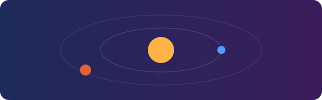

# Project Aurora

A tiny **Markdown** demo for *Viewer* — rendered the way you'd expect on GitHub.



## Features

- [x] Tables, task lists and ~~strikethrough~~
- [x] Syntax-coloured code blocks
- [ ] Your feature here

| Planet | Moons | Rings |
|:-------|------:|:-----:|
| Earth  | 1     | No    |
| Saturn | 146   | Yes   |

> Simplicity is the ultimate sophistication.

```swift
struct Planet: Identifiable {
    let id = UUID()
    var name: String
    var moons: Int
}
```

See the [other notes](notes.txt) or visit [apple.com](https://www.apple.com).
